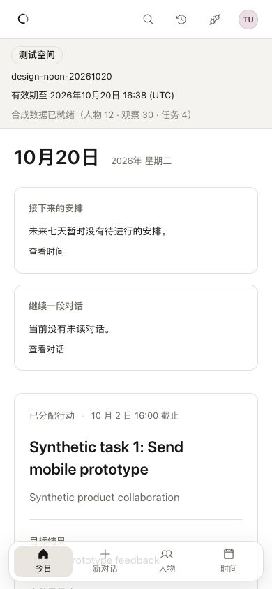
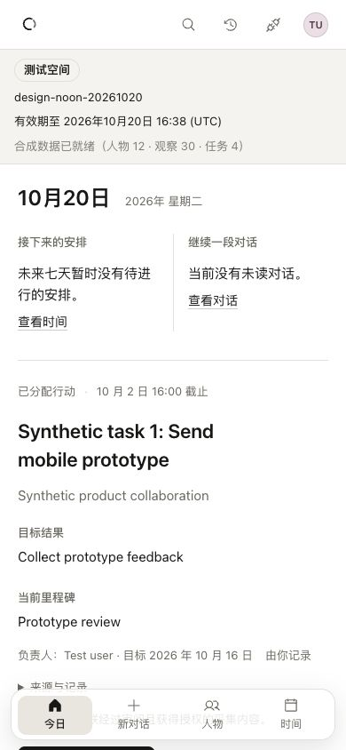
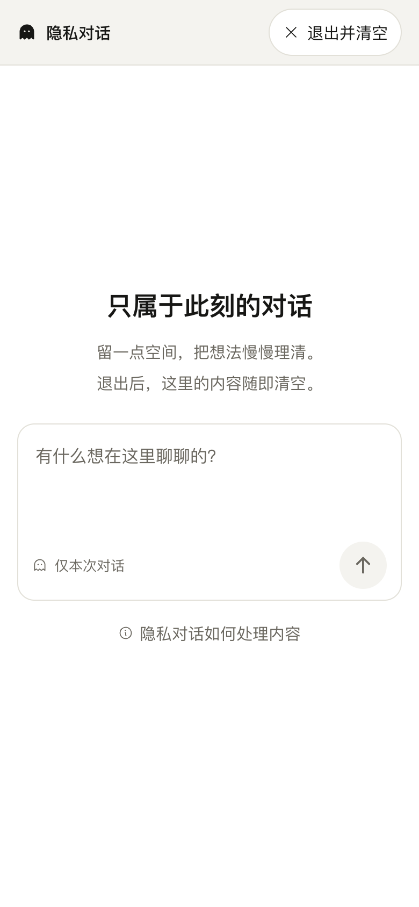
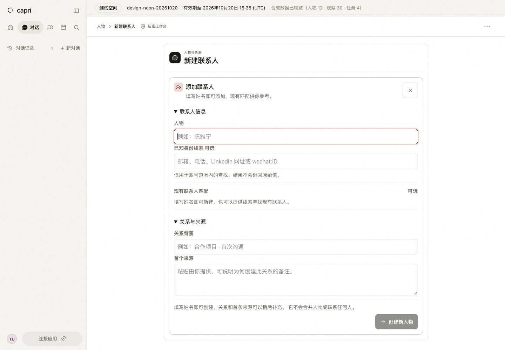
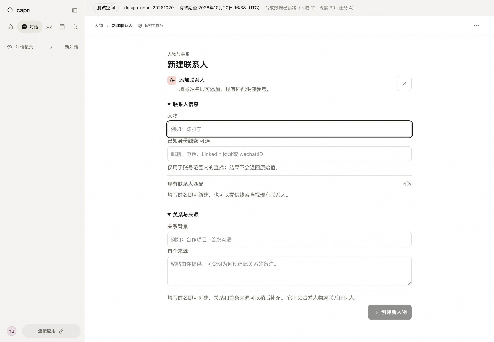
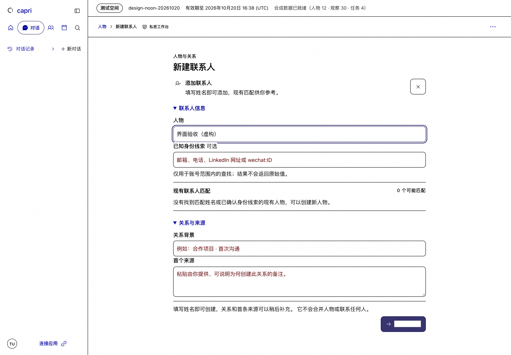
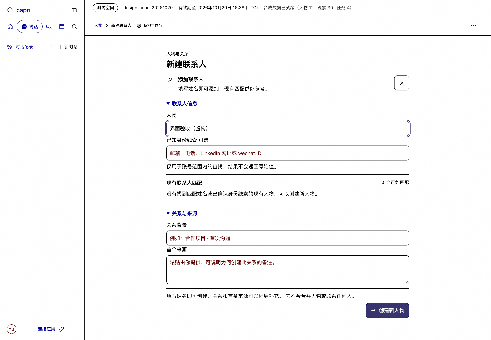

# Web and macOS craft session — noon handoff

2026-10-20 · Asia/Shanghai · implementation frozen at11:30 · final resource and evidence checks continue through12:00.

## Result and release status

The workspace now gives more space to actual work, uses a more consistent reading scale, and has clearer keyboard and recovery states. Changes are small, independently reviewed commits on `codex/design-noon-20261020`; the primary checkout and unrelated work remain untouched. Business data, identity rules, model calls and consequential actions are unchanged.

**Active Web:** `2b4cd303b08d868daad9abd45cf984c0085315a3`, build `CUmCARtl8cbaMXZZgPw1m`. Its clean build,40.41s activation and23.24s locked restart pass. HTTPS certificate/login and API/database readiness pass.

**Committed candidate:** `1c7e1a4a6ebb797ac039b005534df96186287298`, build `K1LOQCHQFtwESnV-W2-Ah`, corrects an unreadable enabled action label in forced colors. Compile, TypeScript,47 static pages,75 relevant tests, lint and independent review pass. Actual same-draft screenshots prove its correction in a task-only preview of the clean production output. **It is not deployed:** two unchanged-gate activation attempts fail authentication readiness and automatically restore2b4cd303. The exact delay remains unconfirmed; a later protected page and authentication probe verify rollback recovery. A later5-second HTTPS login probe times out again while API readiness returns200; Web availability remains intermittent. The real sign-out page subsequently renders. This is not a final all-green runtime claim.

**macOS:** installed0.2.8(125) is unchanged. Earlier shared-style changes have real1123×865/900×720 proof, including Time, Extensions and Person. Latest Time inspector/composer/private/contact after-proof is incomplete: an expired session enters normal browser sign-in, but exchange readback remains unresolved; one new prepare attempt fails connectivity. No cookie injection, client replacement or auth-source change is used. Native appearance/System reset remains an explicitly rejected unproven direction.

[Full design log](../../../design-log.md) · [active plan](../../../plans/2026-10-20-design-noon.md) · [visual comparison board](comparison.html) · [activation/restart receipts](resident-proof/final-restart.json) · [last deployment failure](resident-proof/backplate-retry-activation.json)

## What improved

| Area | Observable change | Proof and limits |
|---|---|---|
| Today |24px heading, quiet summary rows, fewer nested panels, one primary action; mobile task appears155px earlier:625.30→469.89px. |[Before](round-01/web-390-before.jpg) / [after](round-01/web-390-after.jpg);39 relevant tests; real light/dark/error/keyboard and resident proof. Native summary recovery was later verified without a source change. |
| Time | One view track and quieter utilities; first mobile record703.67→594.17px. Empty heading728.28→639.92px; concrete network recovery copy. |[Toolbar](round-02/verification.json), [empty/error](round-04/verification.json);38 relevant tests. Week/month URL and local grid scroll retained.320px date wrapping remains. |
| People | Heading/Add share a row; default search/count share a row. First result483.88→394.38px. |[Before](round-03/web-390-before.jpg) / [after](round-03/web-390-after.jpg);32 tests,320px query/clear/focus, light/dark, same12 synthetic people. |
| Shared shell and utilities |15px substantive reading,13px metadata,44px controls,180ms motion and explicit focus/forced-color states in the changed components. Extensions become an unframed readable catalogue. |[Shared shell](round-05/verification.json), [Extensions](round-06/verification.json);59/28 relevant tests. This is not a claim that every legacy component has migrated. |
| Settings | Reading instructions and values15px, narrow editable fields16px,44px navigation targets and quiet selected state. |[Settings](round-07/verification.json);58 tests; actual search/URL/keyboard/dark/forced-color plus clearly labeled readonly/error layout fixture. Device Settings is pure native and unchanged. |
| Person | State explanations use15px body type. At900px with expanded rail, memory reading width272→604px; stacked layout retains all lower content. |[Reading type](round-09/verification.json), [narrow layout](round-11/verification.json);41 tests; real Web and safe fictional native before/after. |
| Time editor | Escape follows existing dirty/unknown confirmation, respects IME/child controls, returns focus to the true trigger. Closed inspector uses explicit existing open state. |108 relevant tests plus40 inspector tests. Actual dirty-cancel/close verified; native narrow empty-panel correction still needs fresh after-proof. |
| Composer | Popup uses the outer composer and actual clipping/viewport bounds.390px first-option center hit changes false→true; stationary pointer no longer overrides keyboard selection. |[390px](round-12/web-menu-first-390.png), [320px](round-12/web-menu-320.png), [final keyboard](round-12/keyboard-last-final.jpg);47 tests. Existing short-window inline policy remains scrollable. Fresh resident/native replay is incomplete. |
| Private conversation | Removes one redundant welcome ornament from empty/loading states;24px heading,15px body,16px narrow input, solid hairline composer,44px controls, reachable expanded disclosure. |19 parent tests;212 additional worker regressions. Actual1440/390 light and390×568 expanded top/end pass;320px light inspected. Final dark/forced/error-response and native after-proof are not completed. No private message is sent. |
| Contact entry | Removes the standalone outer/inner card stack and repeated heading glyph; fields302px instead of290px at390, title24/body15/input16/focus2. Embedded cards keep their frame. |75 tests; actual1440/390 light,320 dark focus and cancel. Mobile screenshot is focus-autoscrolled, so vertical position is not a matched improvement. Final forced-color label fix is candidate-only. No Create action is executed. |

Counts are per bounded batch, not an added unique-test total. Unit behavior, synthetic source-CSS fixtures, real product states and deployment proof are labeled separately throughout the log.

## Key comparisons

Screenshots retain their original pixels. Comparisons use the stated CSS viewport; different DPR exports are displayed at equal CSS width. No private unmarked identity or unrelated conversation title is included.

### Today ·390×844 · same synthetic work

|Before|After|
|---|---|
|||

### Person ·900×720 native window · same fictional person and two memories

Before uses resident7c526fb0; after uses576a1b8b. Both rails are collapsed. The272→604px measurement above belongs to the expanded-rail Web comparison, not this native pair.

|Before|After|
|---|---|
|||

### Private conversation ·390×844

|Before|After, active2b4 source|
|---|---|
|||

### Contact entry ·1440×1000 · empty form, focused name

|Before|After, active2b4 source|
|---|---|
|||

### Forced-color action ·1440×1000 · same unsent fictional name

**The right image is a clean candidate preview, not the active release.**

|Before, resident2b4|After, candidate1c7|
|---|---|
|||

## Distance from the reference bar

The content hierarchy and small-window reading are materially improved. Overall parity with Ambi, Linear, Notion or Things is **not established**. The strongest remaining gaps are repeated native/Web chrome, native dark-titlebar ownership, the mobile Settings category stack, legacy typography outside migrated components, and stability/recovery states that interrupt an otherwise quiet canvas.

The reference criteria come from the user's brief. Public Ambi/Things references and permitted live surfaces informed the review; no complete Notion-app comparison or objective competitive score is claimed. Private Linear workspace captures are excluded from published artifacts.

## Next five priorities

1. **Finish the release and native acceptance boundary.** Diagnose authentication readiness and Mac browser-login recovery. Activate1c7 only through the existing gates; then repeat latest1123/900 native and protected Web proof.
2. **Resolve native chrome ownership.** Establish a tested titlebar/material/appearance contract that correctly returns to System, then remove repeated branding/navigation only after a concrete structural decision. The three disposable probes do not justify a production bridge.
3. **Rework narrow navigation deliberately.** Replace the three-row Settings category block with a tested chooser or scrolling track; retain all seven destinations, keyboard access, active URL state and discoverability. Keep the QA-only banner separate from production navigation judgments.
4. **Complete the shared reading system.** Migrate remaining14px conversation body and12px legacy utilities to the owned scale, consolidate competing global overrides, and verify Chinese/English long text at equal scale before changing density.
5. **Complete real state coverage.** Exercise long conversations, loading/queued/error/retry/deletion and disabled selected matches on supported Web/native surfaces. Preserve visible uncertainty, drafts, exact source access and one clear next action; do not fabricate live states to obtain screenshots.

## Delivery and cleanup

No business record, message, model request, person merge or consequential external action is performed. The daily preset's synthetic fixtures are used in the named isolated run; test-account cleanup is recorded in the final receipt. Native browser sign-in is the specified primary account's ordinary same-device flow, not a test-data migration.

Canonical learning stays narrow: the design system now requires readable actual forced-color labels and focus/selected/disabled distinctions with system colors. Computed colors alone are insufficient. Current failures and investigation samples stay in this dated log.

Final cleanup/readback details: [handoff receipt](handoff.json).
