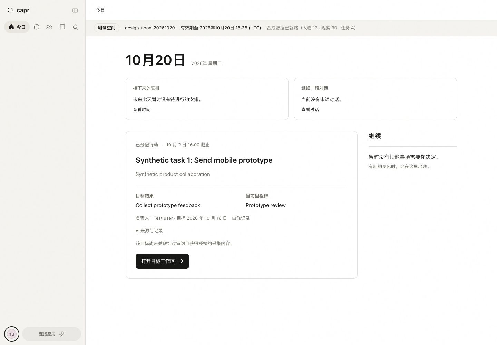
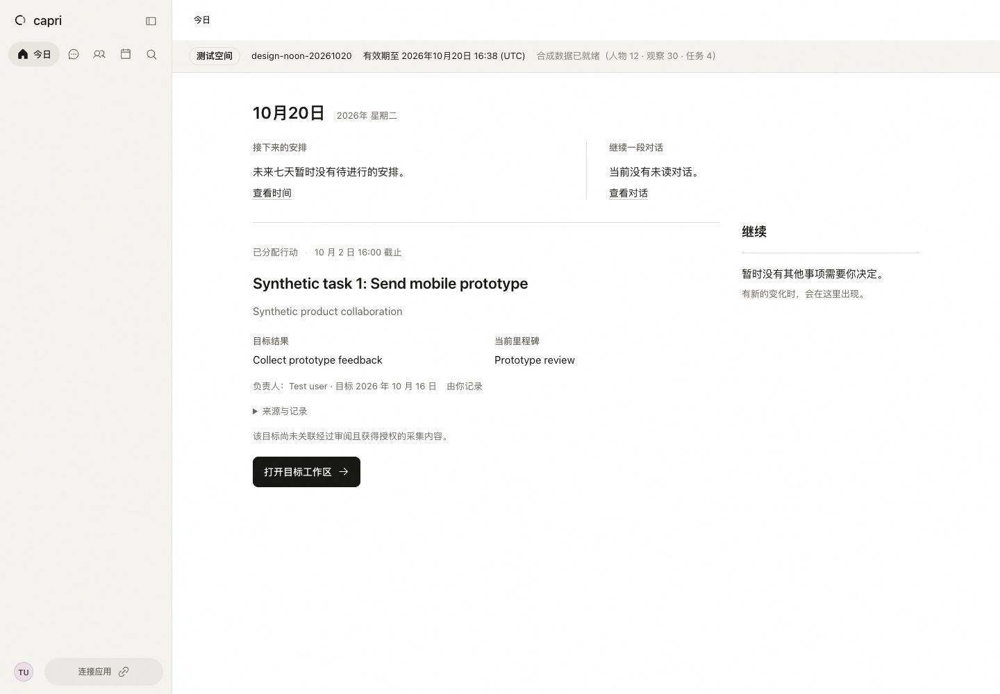
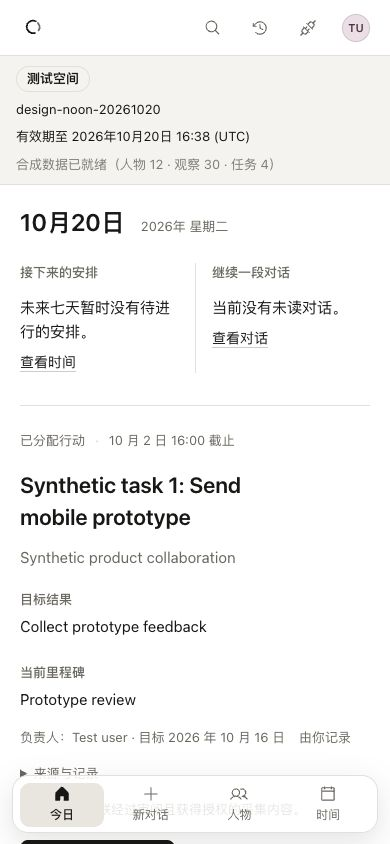

# Design log

## 2026-10-20 — Web and macOS craft session

Work window: 00:36–12:00 Asia/Shanghai. New implementation stops at 11:30.

The surface is the signed-in personal workspace: resume a conversation, find a person, understand today's unfinished work, and review time. Content and the next useful action lead; utility chrome remains secondary. Business logic, records, and feature availability remain outside this session's changes.

Baseline source: remote main `1c7c9891`; resident Web `20c0d64a`; macOS uses the same resident workspace inside AppKit. See [active plan](plans/2026-10-20-design-noon.md) for evidence locations and verification state.

### Reference criteria

- [Ambi](https://www.ambi.ai/en): restrained composition and quiet chrome.
- [Linear](https://linear.app): precise alignment and information density.
- [Notion](https://www.notion.com/product): content priority and subtle separation.
- [Things](https://culturedcode.com/things/): native window rhythm and clear task hierarchy.

Reference parity is a visual judgment, never established by passing functional tests alone.

### Pending decisions

No structural change is approved by this log. Candidates discovered during inspection will be recorded here before implementation.

### Loop 0 — baseline inspection

The conversation canvas is already calm, with a single composer and secondary prompts. The installed macOS app initially shows an expired-session recovery state. The shared Web workspace is the primary opportunity to improve both platforms consistently.

### Loop 1 — Today becomes a brief, not a dashboard

**Decision:** accepted after matched local visual inspection. Resident activation and installed macOS after-captures are still pending; this is not yet a deployment claim.

The oversized date and three rounded panels gave empty summaries more weight than the assigned action. The shared Today styles now use the workspace 24px title, quiet metadata, whitespace and one low-contrast separator. The actual task, outcome and milestone share one left edge. The target workspace link remains the sole filled primary action; optional Agent controls are secondary. No record, authority, route or action behavior changes.

At 390px, two short status summaries remain side by side. A populated title receives the full reading width in stacked rows. The initial all-stacked alternative was rejected because it recovered too little space. Long strings wrap, and keyboard focus, reduced motion and forced-color styling remain explicit.

| Surface | Before | After |
| --- | --- | --- |
| Web · 1440 × 1000 |  |  |
| Web · 390 × 844 |  |  |

The matched synthetic workspace retains the same test banner and content. The mobile before-capture is from resident Web `20c0d64a`; the after-capture is the local candidate based on `1c7c9891`. The malformed local mobile image was rejected. At 390px the settled task heading begins at 469.89px instead of 625.30px (155.41px earlier); horizontal overflow is absent. Desktop task position and primary action also move upward. This establishes improved content visibility, not visual parity with the reference products.

Additional states: [dark desktop](design-log/2026-10-20/round-01/web-dark-1440-after.jpg), [dark mobile](design-log/2026-10-20/round-01/web-dark-390-after.jpg), [unavailable summaries](design-log/2026-10-20/round-01/web-error-1440-after.jpg). Requests were blocked only within the local QA tab, then unblocked; keyboard Retry restored both summaries. Enter toggled the source disclosure without changing state. Reduced-motion emulation reduced the link transition to 0.00001s. A transient real health warning was observed and recovered independently; it is not attributed to this CSS change.

Independent source review closed the initial P2 timing and font-weight findings and found no P0/P1. Final source diff fingerprint: `e6b3534d13f479474f7af4d6c2e2cfe077d0a29c68c773d2cf2b8e4324c23cf6`. Populated-summary mobile layout is source-reviewed but has not yet been visually exercised against live populated data. Final focused tests passed: 39 tests across Today context, its data helpers and pursuit Today rendering. `pnpm docs:check` passed. Production build, live revision, native screenshots and restart proof remain required.
