# Design log

## 2026-10-20 — Web and macOS craft session

Work window: 00:36–12:00 Asia/Shanghai. New implementation stops at 11:30.

The surface is the signed-in personal workspace: resume a conversation, find a person, understand today's unfinished work, and review time. Content and the next useful action lead; utility chrome remains secondary. Business logic, records, and feature availability remain outside this session's changes.

Baseline source: remote main `1c7c9891`; resident Web `20c0d64a`; macOS uses the same resident workspace inside AppKit. See [active plan](plans/2026-10-20-design-noon.md) for evidence locations and verification state.

### Reference criteria

- [Ambi](https://www.ambi.ai/en): restrained composition and quiet chrome.
- [Linear](https://linear.app): precise alignment and information density.
- [Notion](https://www.notion.com/product): content priority and subtle separation.
- [Things](https://culturedcode.com/things/): native window rhythm and clear task hierarchy.

Reference parity is a visual judgment, never established by passing functional tests alone.

### Pending decisions

The native window and Web sidebar both repeat branding and navigation chrome. A unified desktop title/navigation treatment may be worthwhile, but it changes window structure and remains deferred. The current session first improves shared content and control hierarchy without changing navigation architecture. Mobile Settings currently places seven section links above the content in three rows. A compact section chooser or a single scrolling tab rail could improve first-screen access, but changes navigation structure and remains a pending decision. Native dark content also retains a white titlebar in the installed client. A window-scoped appearance contract is pending: the disposable Loop 8 probe did not establish reliable system-mode reset, so no production bridge is added.

### Loop 0 — baseline inspection

The conversation canvas is already calm, with a single composer and secondary prompts. The installed macOS app initially shows an expired-session recovery state. The shared Web workspace is the primary opportunity to improve both platforms consistently.

### Loop 1 — Today becomes a brief, not a dashboard

**Decision:** accepted and deployed for Web; installed macOS layout is visible, with summary settling still under investigation.

The oversized date and three rounded panels gave empty summaries more weight than the assigned action. The shared Today styles now use the workspace 24px title, quiet metadata, whitespace and one low-contrast separator. The actual task, outcome and milestone share one left edge. The target workspace link remains the sole filled primary action; optional Agent controls are secondary. No record, authority, route or action behavior changes.

At 390px, two short status summaries remain side by side. A populated title receives the full reading width in stacked rows. The initial all-stacked alternative was rejected because it recovered too little space. Long strings wrap, and keyboard focus, reduced motion and forced-color styling remain explicit.

| Surface | Before | After |
| --- | --- | --- |
| Web · 1440 × 1000 |  |  |
| Web · 390 × 844 |  |  |

The matched synthetic workspace retains the same test banner and content. The mobile before-capture is from resident Web `20c0d64a`; the final light after-captures are resident `40166aab`, which preserves concurrently deployed `06770526`. The malformed local mobile image was rejected. At 390px the settled task heading begins at 469.89px instead of 625.30px (155.41px earlier); horizontal overflow is absent. Desktop task position and primary action also move upward. This establishes improved content visibility, not visual parity with the reference products.

Additional states: [dark desktop](design-log/2026-10-20/round-01/web-dark-1440-after.jpg), [dark mobile](design-log/2026-10-20/round-01/web-dark-390-after.jpg), [unavailable summaries](design-log/2026-10-20/round-01/web-error-1440-after.jpg). Requests were blocked only within the local QA tab, then unblocked; keyboard Retry restored both summaries. Enter toggled the source disclosure without changing state. Reduced-motion emulation reduced the link transition to 0.00001s. A transient real health warning was observed and recovered independently; it is not attributed to this CSS change.

Independent source review closed the initial P2 timing and font-weight findings and found no P0/P1. Final source diff fingerprint: `e6b3534d13f479474f7af4d6c2e2cfe077d0a29c68c773d2cf2b8e4324c23cf6`. The populated-summary branch was also exercised with an isolated, clearly labeled [source-CSS layout fixture](design-log/2026-10-20/round-01/css-fixture-populated-390.jpg): titles receive 350px at 390 and 280px at 320, with no overflow and a visible 2px keyboard outline. This is synthetic layout proof, not a live populated-record claim. Final focused tests passed: 39 tests across Today context, its data helpers and pursuit Today rendering. `pnpm docs:check` passed. A clean detached production build and activation passed. [Verification receipt](design-log/2026-10-20/round-01/verification.json) binds revision `40166aab` to build ID `3eHsC9QkVQxOaQMMKZZfo`; loopback authentication, certificate-validated Tailscale login, protected synthetic Today and launchd restart recovery passed. The first activation safely refused another installer's lock; its completed `06770526` was merged before rebuilding rather than overwritten. Native 0.2.8 shows the new CSS and ⌘K/Esc works, but both summaries remain loading after background reload; normal native summary proof is outstanding. Independent static review found no CSS cause and identified the existing hidden-page early return as a hypothesis requiring runtime evidence.

### Loop 2 — Time controls recede behind the records

**Decision:** accepted and deployed for Web; native Time empty state verified at both sizes. Today summary completion remains open.

The date, independently boxed view controls and framed review row consumed the first mobile screen. The Time component now uses a single view track, quieter date and filter controls, inline range metadata and an unframed review disclosure. Add schedule remains the only filled toolbar action. This is one CSS module; no feature, record, URL or action logic changes.

| Surface | Before | After |
| --- | --- | --- |
| Web · 1440 × 1000 | 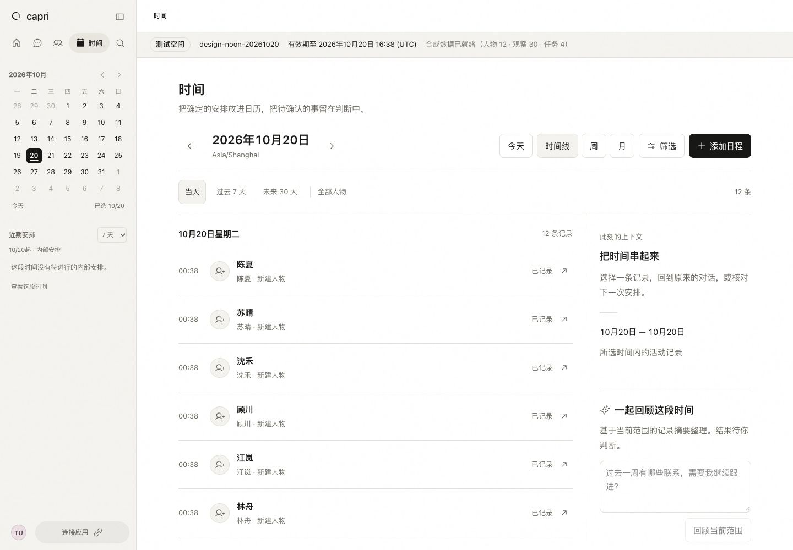 | 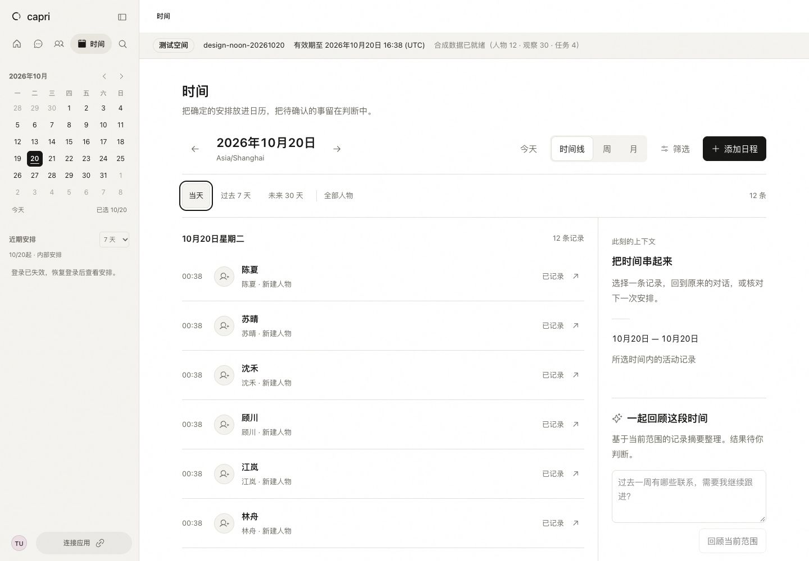 |
| Web · 390 × 844 |  |  |

The matched synthetic records begin at 594.17px instead of 703.67px at 390: 109.5px earlier. Default toolbar controls use two rows. An [enabled filter](design-log/2026-10-20/round-02/web-390-filter-enabled.jpg) deliberately wraps to three rows to retain its full state label. At 320 the date wraps; this remains a craft gap, without page overflow. [Dark desktop](design-log/2026-10-20/round-02/web-dark-1440-after.jpg) and [dark mobile](design-log/2026-10-20/round-02/web-dark-390-after.jpg) retain hierarchy. Final light screenshots come from resident `38fa6c00`, build `MakeWxrw-wksqlK0dm4LM`; its sidebar reads the actual empty schedule state. The earlier local preview showed a separate session-expired sidebar status and was replaced in the formal light comparison.

Actual forced-color screenshots exposed Canvas text backplates obscuring light labels. The final narrowly scoped rules use the user's system palette and disable backplates only for filled primary and selected/expanded controls. Their hover styles preserve those colors. [Verified result](design-log/2026-10-20/round-02/web-forced-colors-after.png). The existing small-calendar selected label has the same backplate problem outside this module and remains a separate follow-up. [MDN's forced-colors guidance](https://developer.mozilla.org/en-US/docs/Web/CSS/Reference/At-rules/%40media/forced-colors) supports this targeted treatment.

All toolbar targets remain at least 44px tall. Enter opens/closes the native details disclosure with a 2px focus outline. Week/month state appears in the URL; the narrow week grid scrolls locally, while the page remains within 390px. Reduced motion removes transitions. Typecheck and 38 focused tests across Time views, workspace and date helpers passed; worker lint passed. Independent review found no new concrete P0/P1/P2 at final CSS diff `f8df2bec04331bc254c7a6a6cbc684a1ed5569eb01351b7be9a7e0663fd6a91c`. A clean detached production build, loopback authentication and certificate-validated HTTPS passed. Launchd recovery exceeded the initial 25-second readiness window, then recovered without another restart; subsequent authentication, HTTPS and protected records passed. Logs show delayed configuration injection before Next became ready. See [verification receipt](design-log/2026-10-20/round-02/verification.json).

Native Time: [1123 × 865](design-log/2026-10-20/round-02/macos-default-after.png), [900 × 720](design-log/2026-10-20/round-02/macos-narrow-after.png). Normal quit/reopen restored navigation and ⌘K/Esc after an unresponsive WebView observation. This is actual empty-state proof, not a populated-record comparison. Narrow-window empty copy sits too low and is the next visual target. The Today summaries still load indefinitely in these observations; no runtime cause or product fix is claimed.

### Loop 3 — People reaches the list sooner

**Decision:** accepted and deployed for Web.

The mobile heading, Add contact and result count consumed three unnecessary rows. The heading and Add contact now share a row; default search and count share another. A committed query gives the input its full width so Clear and Submit remain usable. Long heading explanations and counts can wrap. No person field, search rule, route, return-session behavior or action changes. Row and arrow transitions use the shared 180ms duration.

| Surface | Before | After |
| --- | --- | --- |
| Web · 390 × 844 |  |  |
| Web · 1440 × 1000 |  | 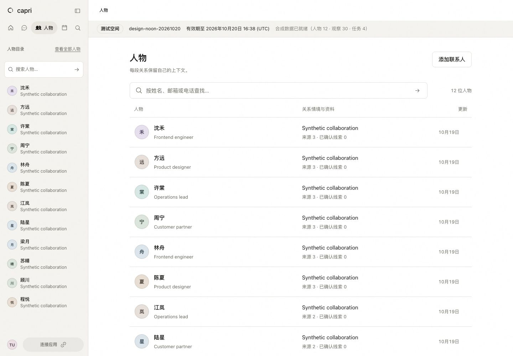 |

The same 12 synthetic people remain visible. At 390px the first row starts at 394.38px instead of 483.88px: 89.5px earlier. Desktop composition remains intentionally stable. [Dark mobile](design-log/2026-10-20/round-03/web-dark-390-after.jpg), [dark desktop](design-log/2026-10-20/round-03/web-dark-1440-after.jpg), and [320px no results](design-log/2026-10-20/round-03/web-320-no-results.jpg) were checked. At 320 with a query, the input receives 119px and both actions remain 44 × 44px; clearing returns focus to the input with a 2px outline. The long query remains editable and stored in the URL. No page overflow was found. Normal-motion emulation yields 180ms; the current system reduced-motion preference reduces it to 0.00001s.

Independent source review found no concrete P0/P1/P2 at diff `7bd130aeef92dec1182c07a509ead066cf3c97cb9e1f1dc25bc995c49f352219`. All 32 existing directory rendering/navigation/return tests and Web lint passed. Clean production build and activation passed at `46cc6ab3`, build `4Uabjz41gjNtHpWJL6ZiT`; final light comparisons use resident captures with all 12 synthetic people. [Verification receipt](design-log/2026-10-20/round-03/verification.json). The visual judgment follows Ambi's content priority and the reference products' restrained utility hierarchy; it does not establish overall reference parity. Remaining gaps include small sidebar typography, native repeated chrome and Today summary settling. Misrouted or partially painted captures were rejected; only route/theme/content/scroll-matched images are retained here.

### Loop 4 — Empty and failed Time states stay within reach

**Decision:** accepted and deployed; resident and native after-proof verified.

A desktop-height floor pushed the narrow empty-state explanation behind the mobile navigation and below the short macOS window. Below 1000px, stacked rows now follow their content and the status area uses a 224px floor. Desktop composition remains stable. The Time error panel translates three known browser network-failure strings into “暂时连不上服务，请重试。”; other errors and all request, authorization and retry behavior remain unchanged.

| Surface | Before | After |
| --- | --- | --- |
| Web · 390 × 844 · same empty day | 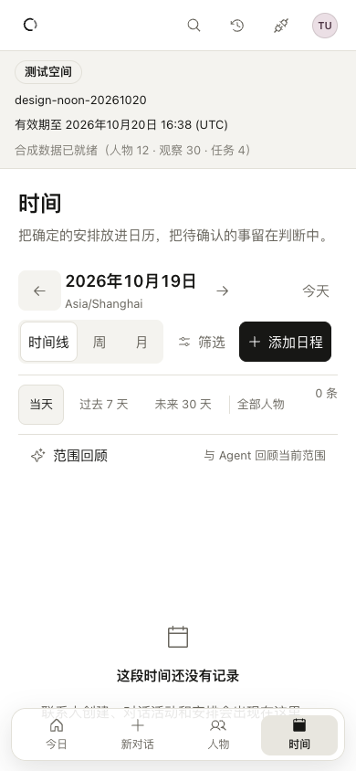 |  |
| Web · 1440 × 1000 | 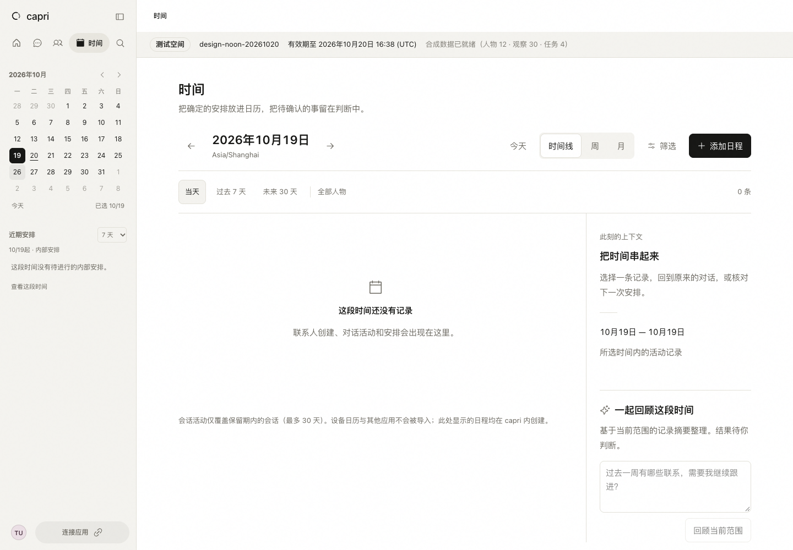 | 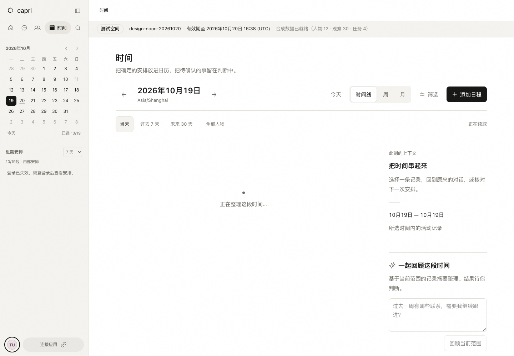 |
| Web · network failure | 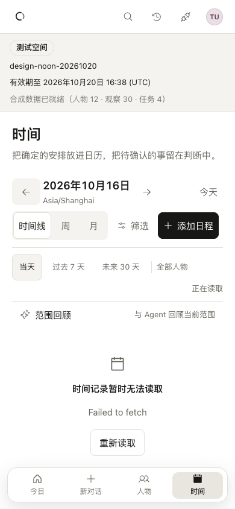 |  |

At 390px the empty heading moves from 728.28px to 639.92px, and its explanation ends at 704.42px. At 1440px the heading remains at 553.22px. [Dark empty state](design-log/2026-10-20/round-04/web-dark-390-after.png), [actual loading](design-log/2026-10-20/round-04/web-390-loading.png), and [320px keyboard-expanded review](design-log/2026-10-20/round-04/web-dark-320-expanded.png) were checked without page overflow. The expanded capture intentionally follows keyboard focus and is scrolled. Error/loading proof uses a temporarily paused or failed Time Fetch in the isolated QA tab, with interception cleared afterward; Enter on Retry restores the real response. No response fixture, record write or authentication bypass is used.

Independent source review found no concrete issue at diff `40b39082a7aea6cba48e61d8f09a54bfb148c644e26796bc9fb4fa199ba8c698`. The 38 existing Time tests, Web lint, typecheck and documentation checks pass after the display-copy change. [Verification receipt](design-log/2026-10-20/round-04/verification.json) records local and deployed proof. Final light images use resident `916c104c`; native Time was verified at both window sizes.

### Loop 6 — Extension choices stop competing with their content

**Decision:** accepted and deployed; resident and native after-proof verified. Loop 5 was verified separately in the same release.

Four full-width black catalog buttons and a black selected direction tab gave utility controls more weight than the service descriptions. Direction tabs now use one fine selected underline. Catalog choices use compact secondary controls within the same existing grid. The outgoing-client empty state uses whitespace instead of another box. Body, error and empty copy use the shared 15px size, with 13px domain/auth metadata. Request, submission and confirmation primary controls remain distinct; no service, permission, route, record or business logic changes.

| Surface | Before | After |
| --- | --- | --- |
| Web · 390 × 844 | 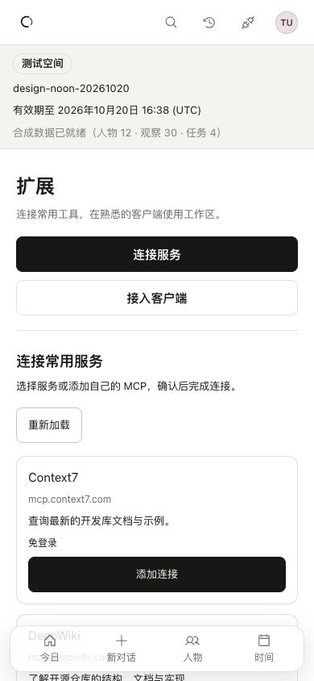 |  |
| Web · 1440 × 1000 | 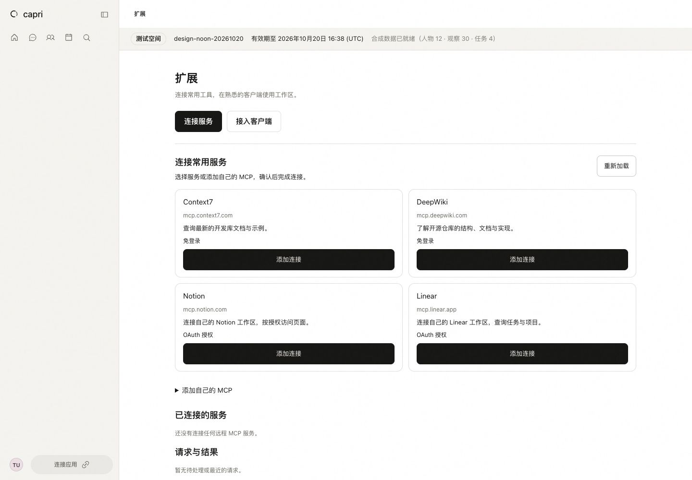 | 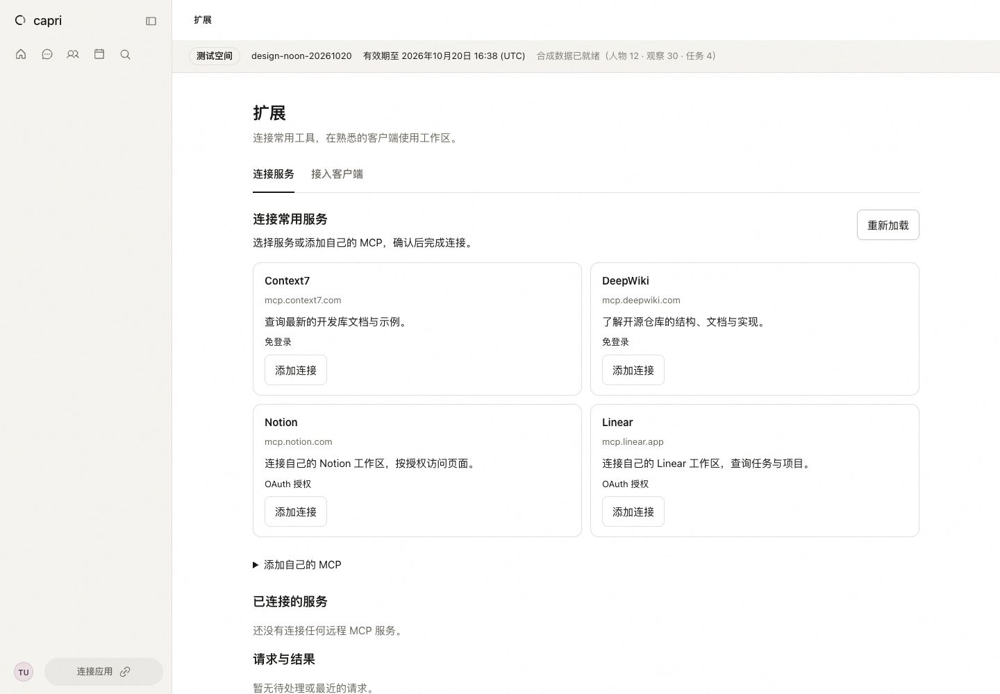 |
| Web · outgoing client empty state | 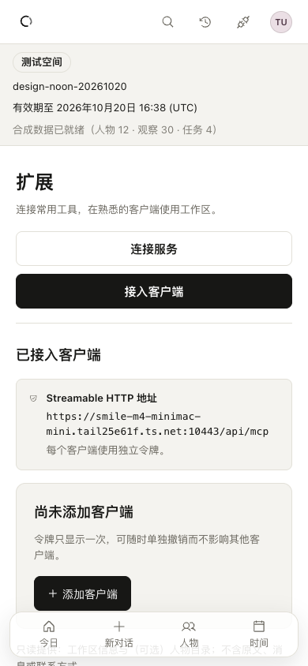 | 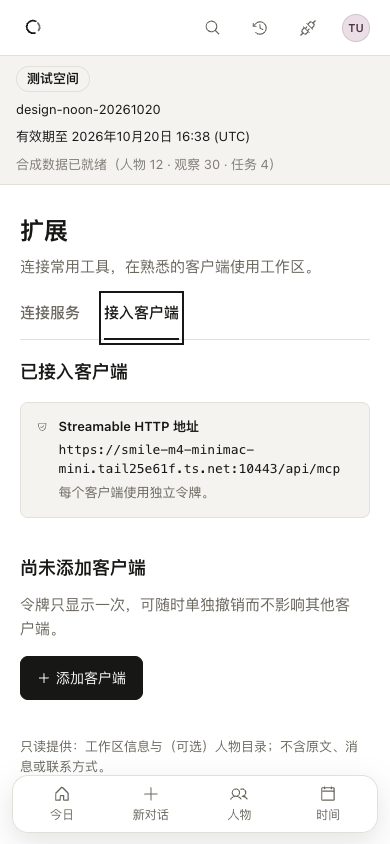 |

At 390px, the first service starts at 494.08px instead of 564.72px: 70.64px earlier. Catalog targets remain 90 × 44px; both direction tabs remain at least 44px tall and sit on one row at 320. The custom form stays within 320px, with 44px inputs and 16px input text. [Dark mobile](design-log/2026-10-20/round-06/web-dark-390-after.png), [dark desktop](design-log/2026-10-20/round-06/web-dark-1440-after.png), [forced colors](design-log/2026-10-20/round-06/web-forced-colors-390.png) and [real read failure](design-log/2026-10-20/round-06/web-error-390.png) were checked. Actual forced-color inspection caught transparent unselected tab borders becoming black; explicit Canvas/Highlight borders fix the ambiguous selection. Arrow keys move selection and focus, and the 2px outline remains visible. Reduced motion removes the 180ms transitions.

A temporarily failed directory Fetch disables all four choices without creating a connection or token. After interception is cleared, keyboard Reload restores all four and removes the error. All 28 existing extension/directory/request tests, Web lint and documentation checks pass. Independent final source review found no concrete P0–P2 at diff `6fa45e851b5e0745b93feadbcbb5a8ab41de8a5b6a415ca601a8df161df45768`. [Verification receipt](design-log/2026-10-20/round-06/verification.json). Scrolled or stale-painted captures were rejected; the final comparison checks viewport, theme and scroll position before capture and visually verifies saved pixels. Final light comparisons use resident `916c104c`. Native after-proof: [1123 × 865](design-log/2026-10-20/round-06/macos-default-after.png), [900 × 720](design-log/2026-10-20/round-06/macos-narrow-after.png). No native before-image was captured, so no paired native improvement claim is made.

### Loop 5 — Shared utilities become legible without growing the shell

**Decision:** accepted and deployed after independent review; resident and native after-proof verified. This bounded batch ran alongside Loop 6 and is committed afterward.

Sidebar names and search results now use the shared 15px body size. Labels, dates, counters and supporting context use 13px metadata. Nonstandard weights collapse into 400/500/600. Existing sidebar widths, calendar cell heights, single-line session titles, truncation and every action remain intact. The compact avatar initials retain their existing geometric sizing. Mobile search entry stays 16px, and its initial/error/no-results explanation uses 15px. Ordinary utility transitions share 180ms; the existing 220ms footer morph remains within the design range.

| Surface | Before | After |
| --- | --- | --- |
| Web · People · 1440 × 1000 | 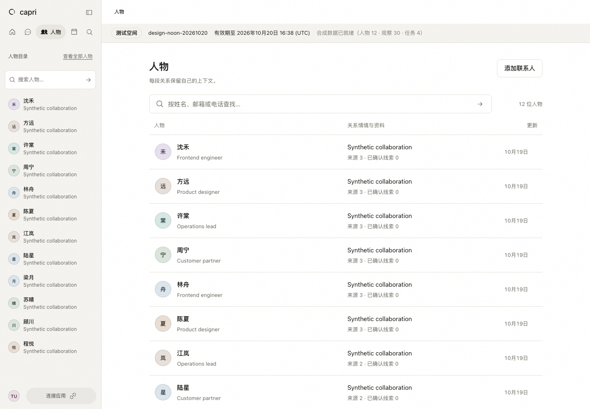 | 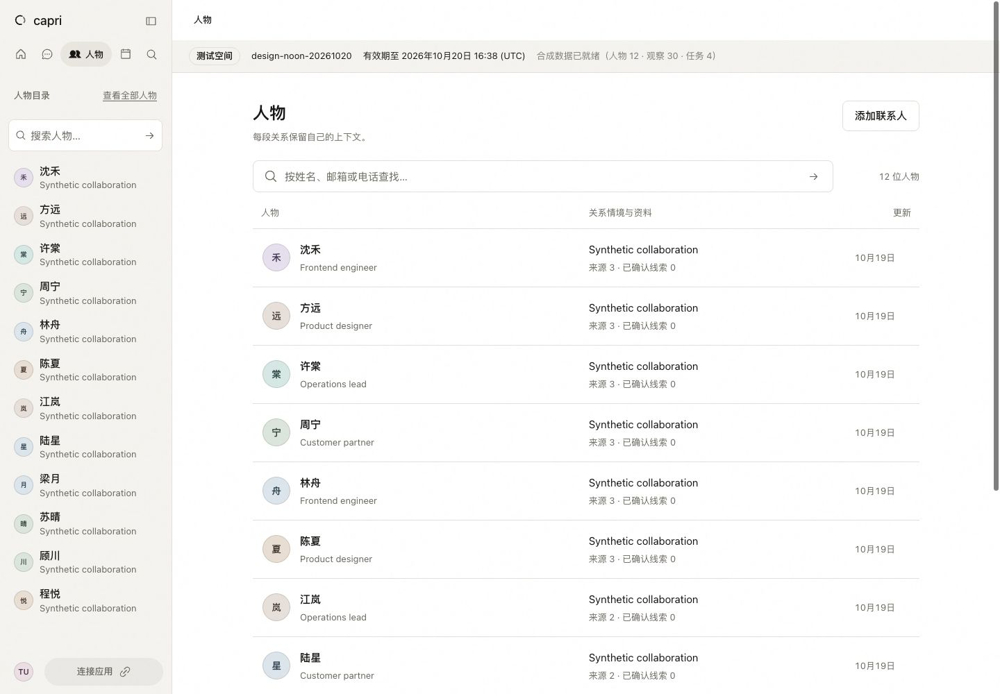 |
| Web · People · 390 × 844 |  |  |
| Web · conversation · 1440 × 1000 | 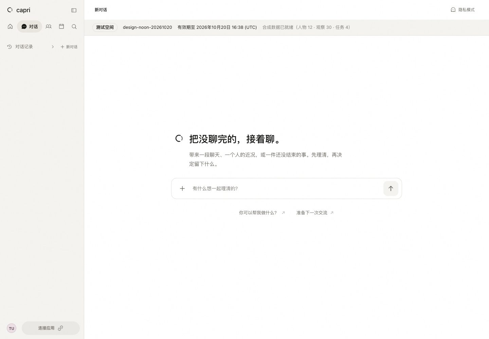 | 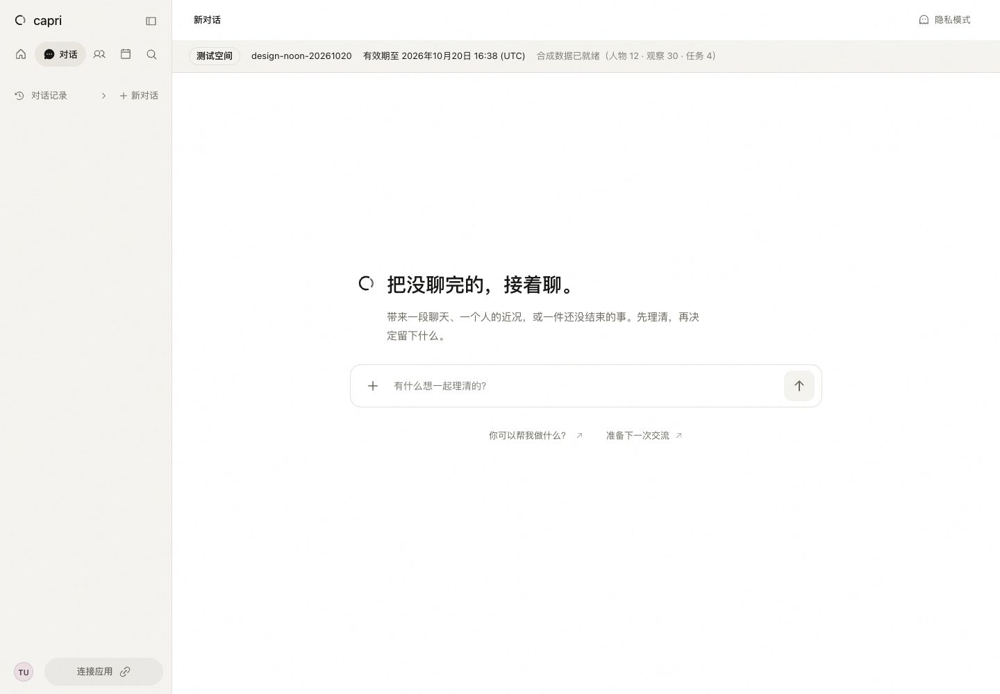 |

The sidebar stays 248px wide. Person rows are 52.39px high; at [900 × 720](design-log/2026-10-20/round-05/people-900-after.png), the sidebar scrolls independently instead of stretching the page. [Collapsed navigation](design-log/2026-10-20/round-05/collapsed-900-after.png) retains all direct routes. Mobile navigation remains 44px tall, with the People list still starting at 394.38px. [Dark People](design-log/2026-10-20/round-05/people-dark-1440-after.png) preserves the same hierarchy.

[Search on desktop](design-log/2026-10-20/round-05/search-1440-after.png), [390px keyboard selection](design-log/2026-10-20/round-05/search-390-after.png) and [320px no results](design-log/2026-10-20/round-05/search-empty-320-after.png) were exercised. Meta+K and Control+K open it, ArrowDown selects a result, Enter opens the actual synthetic person, and Escape closes it. At 320, the dialog is 288px wide and input text remains 16px, without page overflow. Focus is visible at 2px. Computed normal transitions are 180ms; actual reduced-motion transitions resolve to 0.00001s, including the late-defined rail controls.

The [small-calendar forced-color label](design-log/2026-10-20/round-05/time-forced-colors-1440.png) now stays readable on its system highlight. [Cross-month selected date](design-log/2026-10-20/round-05/calendar-selected-outside-forced-1440.png) retains Highlight/HighlightText even when also outside the browsed month. Those state captures include the local preview's separate sidebar authentication error, and one includes a transient actual health/loading warning. They are state-specific proof, not matched normal Time comparisons; the [normal Time after-image](design-log/2026-10-20/round-05/time-1440-after.png) comes from the resident service and shows its healthy empty schedule sidebar.

Independent review caught and closed three P2 issues: selected archived text without a highlight background, reduced-motion rules preceding later transitions, and outside-date GrayText overriding the selected text color. The archived branch is verified by source and review; no records were created to fabricate it. Final three-file diff fingerprint: `55e0177be0d2c5160cddfe0f2050dec8fc688d0e95c94b0e74d2e6aa08d57bb0`. Parent verification passes 59 existing tests across five relevant suites, Web lint and documentation checks; the worker contract's 35 tests and lint also pass. [Verification receipt](design-log/2026-10-20/round-05/verification.json). The stale development CSS was identified by computed 13px versus source 15px, then fixed by stopping the sole owned preview, confirming no open cache files, clearing only its dev cache, and reloading. The final 320px capture is actually 15px.

Native before-images use the same empty Time day on the primary authorized workspace: [1123 × 865](design-log/2026-10-20/round-05/macos-default-before.png) and [900 × 720](design-log/2026-10-20/round-05/macos-narrow-before.png). Native menu navigation and reload restored an inspectable page; the window is restored to its default size. A provisional capture retained an old painted date selection and was replaced after explicit-date reload. After-proof now verifies [1123 × 865](design-log/2026-10-20/round-05/macos-default-after.png), [900 × 720](design-log/2026-10-20/round-05/macos-narrow-after.png), and [actual ⌘K search](design-log/2026-10-20/round-05/macos-search-after.png); Escape returns to Time. Today summaries remain a separate unresolved runtime observation.

### Combined resident proof — Loops 4, 5 and 6

All three bounded batches are active at clean committed revision `916c104c2526cbd0be088ce62ea6ebc66c934a68`, build `5PrRkQAfnP-lkomTIMDmF`. The detached release passed production compilation, type checking and static generation before activation. HTTPS login validates the certificate; the authenticated isolated workspace reads its actual four-entry extension catalog after restart. Launchd recovery took 18.41 seconds, changed the process, restored password-account readiness and retained the same revision/build receipt. API readiness and its database remain healthy; these Web-only changes do not require a backend rebuild.

Native Time uses the same authorized empty workspace and explicit date before and after. The narrow explanation now appears inside the window.

| Native Time | Before | After |
| --- | --- | --- |
| 1123 × 865 | 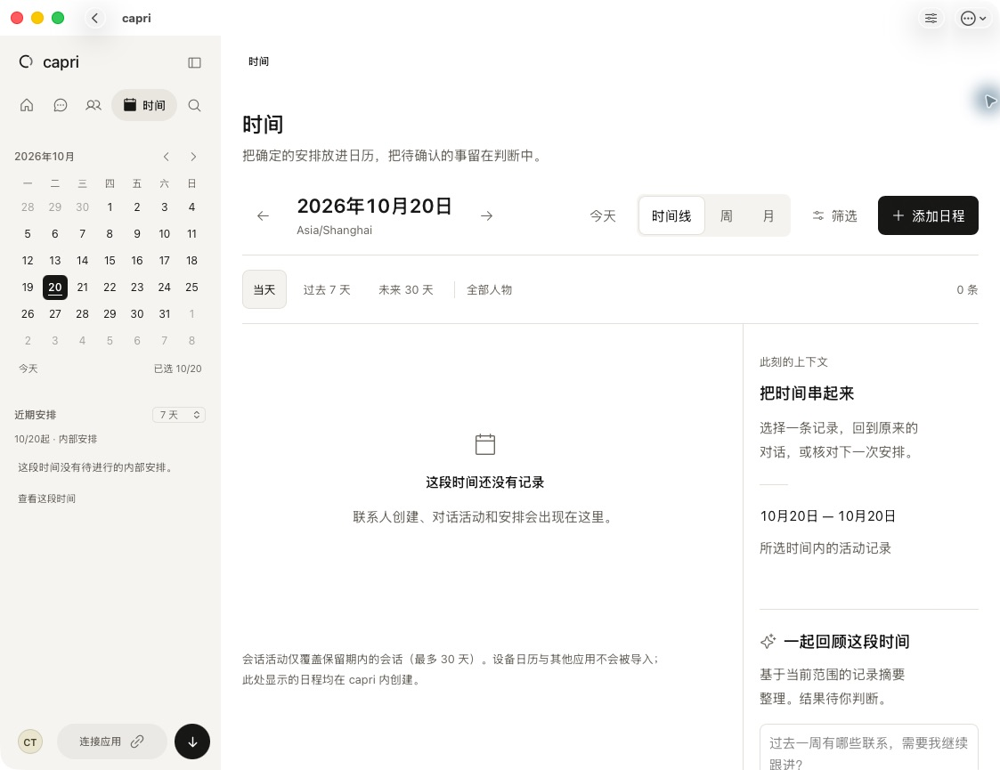 | 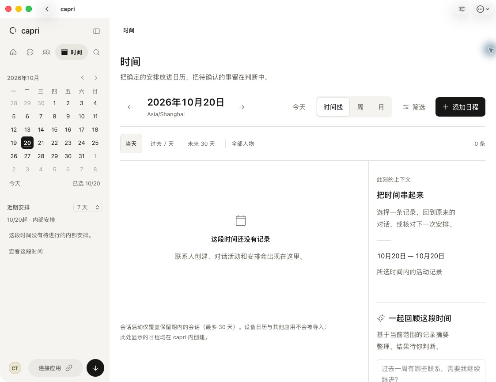 |
| 900 × 720 | 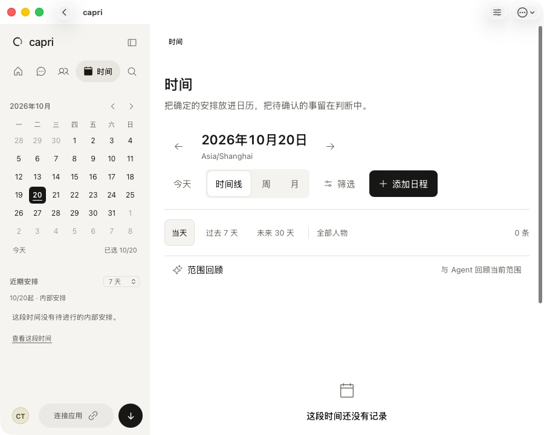 | 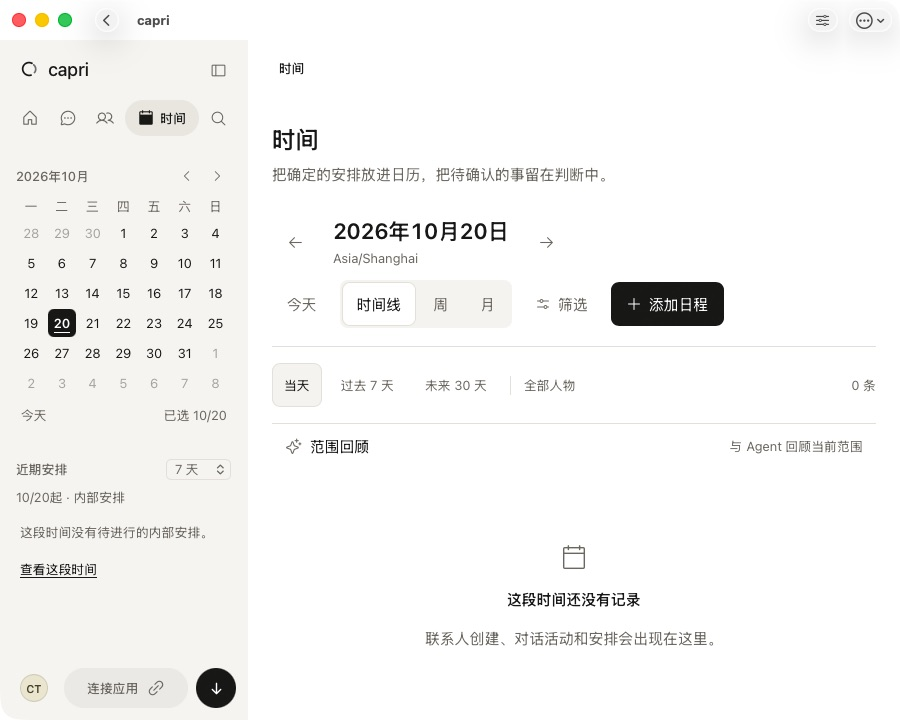 |

The build preparation also inspected host and Docker-VM capacity. Only individually rechecked unused, unshared, reproducible BuildKit records were reclaimed by exact ID. Image, volume and running-container sets remain identical; Docker context stays `colima`. VM free space increased from 2,417,340 to 4,396,992 KiB. Host free space remained above the 30 GiB build threshold. Current and rollback release sources were preserved. Raw cleanup receipts stay in the private task artifact.

### Native Today readback — recovered without a source change

The installed 0.2.8 (125) client eventually returned complete empty schedule and unread summaries after opening the precise installed app through Finder and using its normal Reload control. [1123 × 865](design-log/2026-10-20/round-01/macos-default-settled.png) and [900 × 720](design-log/2026-10-20/round-01/macos-narrow-settled.png) show the settled state at resident `916c104c`. These captures use the primary authorized workspace with visibly labeled fictional tasks, distinct from the isolated Web comparison. The window is restored to default size.

The earlier persistent-loading observations remain real, but neither the hidden-page hypothesis nor a permanent defect was established. The existing shared coordinator already listens for foreground events and bounds visible polling; the sidebar's initial manual read does not use the same hidden guard. No speculative polling, visibility or projection change was made. Independent review and actual recovery close the missing normal-state screenshot, while the precise recovery cause remains uncertain.

### Loop 8 — native appearance boundary, held from production

**Decision:** inconclusive; no production code change.

[Actual native dark Today](design-log/2026-10-20/round-01/macos-dark-settled.png) reveals a white titlebar above dark content. Synchronizing the existing Web preference with just its native window is a worthwhile follow-up, but it must release correctly when the user returns to system appearance. The product was restored to its original light preference after inspection.

A disposable, no-network SwiftUI/WKWebView probe tested window-scoped appearance against synthetic content. It preserves [one decision contract](design-log/2026-10-20/round-08/decision-contract.json), source variants and [observations](design-log/2026-10-20/round-08/verification.json). [Explicit SwiftUI dark](design-log/2026-10-20/round-08/probe-dark.png) reported DarkAqua and Web dark. [Reset to system](design-log/2026-10-20/round-08/probe-system-reset.png) reported native Aqua while Web remained dark on repeated inspection; explicit light restored both. Invalid input retained the current choice. Direct action-time and lifecycle-owner AppKit assignments also produced a mismatch in this probe. Their timing/hosting cause remains a hypothesis. No observed state is called an automated pass, human choice or regression case. The probe process was quit, with no account, network, system preference or production changes.

Apple documents [presentation-scoped preferredColorScheme](https://developer.apple.com/documentation/swiftui/view/preferredcolorscheme(_:)) and [window/view-specific AppKit appearance](https://developer.apple.com/documentation/appkit/choosing-a-specific-appearance-for-your-macos-app). Those interfaces establish the available mechanism; they do not establish correct reset behavior in this host. A stable ownership/reset contract and actual installed-app verification are required before implementation.

### Loop 9 — Person state explanations use reading type

**Decision:** accepted and deployed; resident, native and restart proof verified.

Person content already uses 15px body type, but its empty/help/error/conflict explanations still used 13px metadata. Those substantive passages now use the same 15px reading size. Dates, sources and counts stay at 13px. Narrow editable text uses 16px; relationship-link motion follows the shared 180ms timing. One CSS module changes, with no data, projection, request, action or route changes.

| Surface | Before | After |
| --- | --- | --- |
| Web · 390 × 844 |  |  |
| Web · 1440 × 1000 | 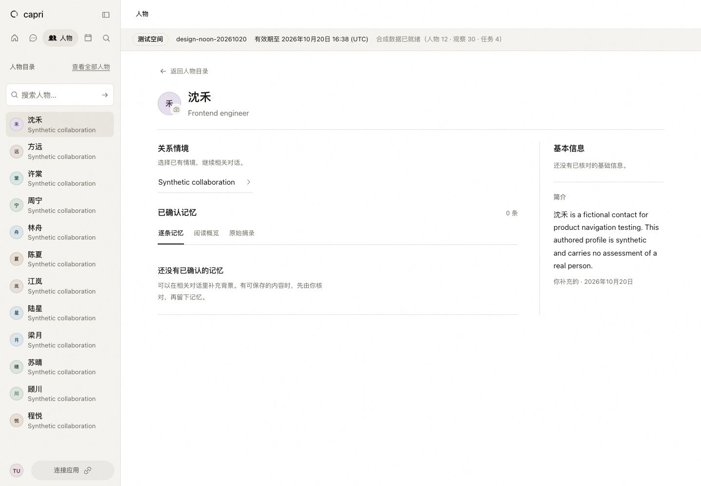 | 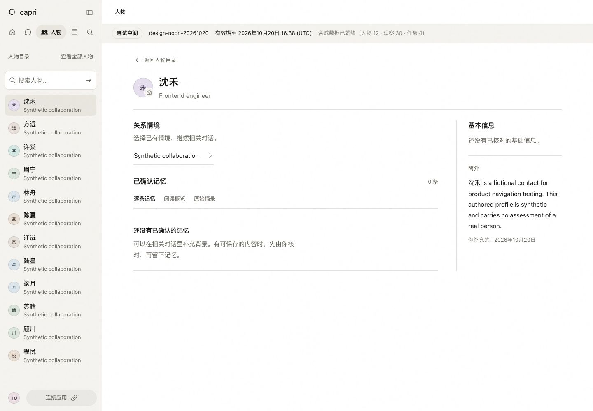 |

Both comparisons show the same isolated synthetic person. Before-images use resident `916c104c`; light after-images now use resident `7c526fb0`; the dark and interaction-state captures use the reviewed local candidate. [Dark mobile](design-log/2026-10-20/round-09/web-dark-390-after.png), [dark desktop](design-log/2026-10-20/round-09/web-dark-1440-after.png), [keyboard reading mode](design-log/2026-10-20/round-09/reading-keyboard-390.png) and [320px original-excerpt mode](design-log/2026-10-20/round-09/raw-keyboard-320.png) retain wrapping and a visible 2px focus outline. No page overflow was found. Actual muted-body contrast is 5.65:1 in light and 8.12:1 in dark. Normal motion is 180ms; the current reduced-motion preference resolves to 0.00001s.

Actual forced-color inspection found all three transparent tab borders becoming visible underlines. [Before](design-log/2026-10-20/round-09/forced-colors-before.png) and [after](design-log/2026-10-20/round-09/forced-colors-after.png) show the narrowly scoped Canvas/Highlight correction. Keyboard selection moves the single Highlight marker to Raw while the other two borders remain Canvas.

A clearly labeled [source-CSS recovery fixture](design-log/2026-10-20/round-09/source-css-recovery-fixture.html) checks unavailable/conflict copy, an unbroken synthetic reference and a readonly editor at [390px](design-log/2026-10-20/round-09/source-css-recovery-390.png) and [320px](design-log/2026-10-20/round-09/source-css-recovery-320.png). Error/conflict text is 15px, input16px and focus2px, without overflow. This is exact-module layout proof, not an actual failed product read, accepted memory or write. It contains no account data or external network dependency. The temporary static server was stopped after returning the QA tab to the healthy resident origin.

All 41 existing Memory interaction/page-render tests pass on final source, along with Web lint. Independent review found no concrete P0–P2 at final diff `f047f9b53e2b1f3a7539100d05edfb9f6559eabf8508b5d7bd0b9830792fa152`. [Verification receipt](design-log/2026-10-20/round-09/verification.json). Native before-images use the primary authorized fictional test person with two existing source-attributed memories, with the sidebar deliberately collapsed to exclude unrelated identities: [1123 × 865](design-log/2026-10-20/round-09/macos-default-collapsed-before.png), [900 × 720](design-log/2026-10-20/round-09/macos-narrow-collapsed-before.png). Native after-images verify the same two fictional memories and collapsed sidebar at [1123 × 865](design-log/2026-10-20/round-09/macos-default-collapsed-after.png) and [900 × 720](design-log/2026-10-20/round-09/macos-narrow-collapsed-after.png). The installed binary remains 0.2.8 (125); the shared Web module reaches its WKWebView. The default window size is restored.

Resident `7c526fb058933d0ffdb057efcbfa00379c1ef42a`, build `SWJjqSYI4_Q3wxzgBvQs0`, comes from a clean committed detached release. Its first activation timed out at authentication readiness and automatically rolled back; the prior protected page remained readable. One controlled retry with identical source/build and unchanged installer gates passed in 42.52 seconds. The precise startup delay remains unconfirmed. A later locked launchd restart recovered in 9.96 seconds, changed its process and retained the same receipt. HTTPS login validates its certificate, password-account readiness returns, API/database remain ready, and the real isolated Person page still renders 15px help after restart. No backend or native binary change was needed.

### Loop 7 — Settings reading hierarchy and complete control states

**Decision:** accepted and deployed; resident and restart proof verified. This bounded batch began before Loops 8 and 9 and is committed afterward.

Substantive settings instructions, field values, labels, actions and recovery errors now use 15px reading type. Metadata remains 13px, titles 24px and weights 400/500/600. Mobile editable search/forms use 16px; search has one 2px container focus ring. Existing seven category links, permission boundaries, native-surface ownership selectors and theme preview illustrations remain intact. Ordinary transitions use 180ms; reduced motion removes them. Pressed states reuse the existing light/dark `surface-strong` token.

| Surface | Before | After |
| --- | --- | --- |
| Profile ·390 ×844 | 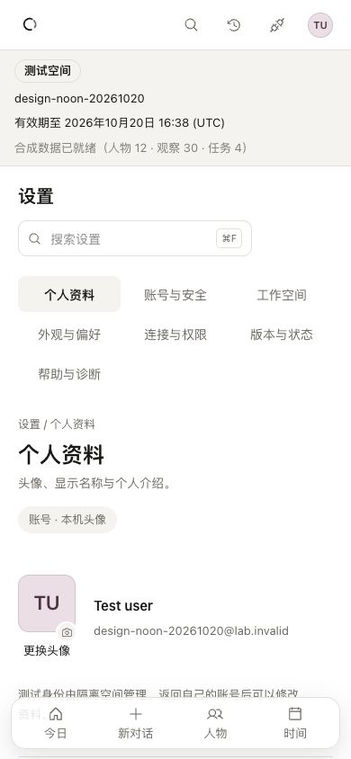 | 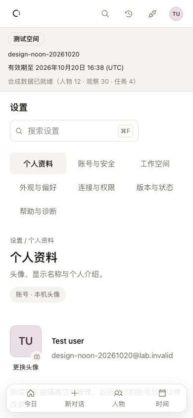 |
| Profile ·1440 ×1000 |  |  |
| Appearance ·1440 ×1000 | 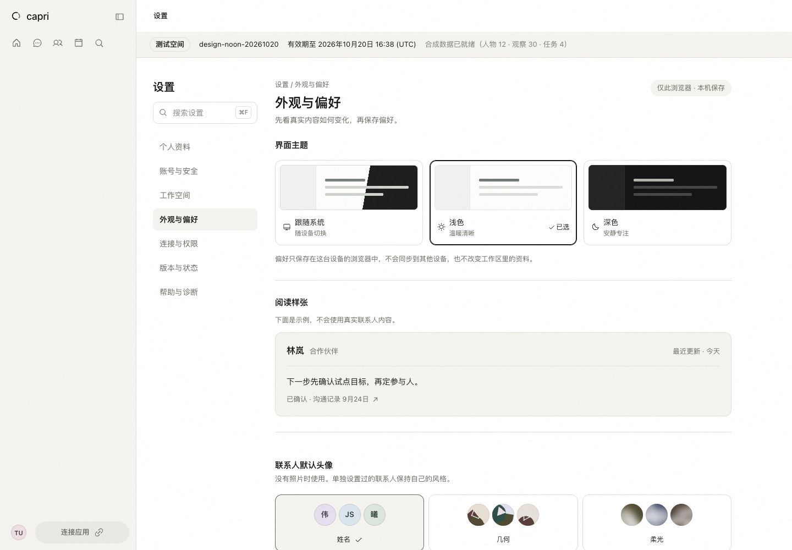 | 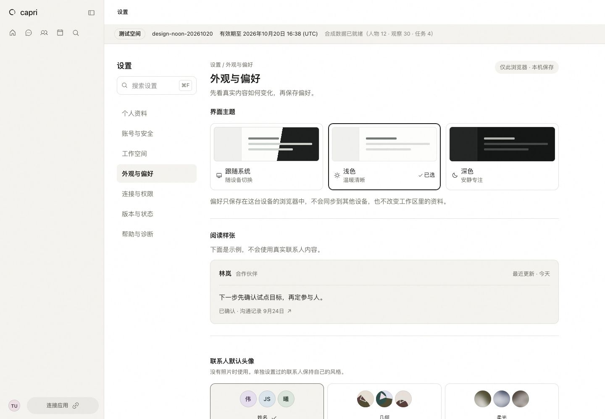 |

Before-images use resident `916c104c`; final light profile/appearance after-images use resident `576a1b8b` in the same isolated synthetic workspace. Search, dark and forced-state captures use the reviewed local candidate. Earlier local captures containing a transient service-health warning were rejected for the normal comparison; the final profile capture has no alert. The 390px profile heading starts 503.89px down, approximately 11px lower as all navigation/search targets become 44px. This is an explicit readability/target-size tradeoff; the three-row category block remains a structural gap. At[320px](design-log/2026-10-20/round-07/profile-320.png), 6px horizontal navigation padding keeps all seven labels on one line and each row 44px tall. The long synthetic email wraps without overflow. No category is removed or hidden.

[Search390px](design-log/2026-10-20/round-07/search-390.png) and[no-results320px](design-log/2026-10-20/round-07/search-empty-320.png) exercise Meta+F, ArrowDown, Enter and Escape. The selected result opens the real `section=versions` URL; Escape clears the query and returns input focus. Search input is 16px, empty copy 15px and the focus outline 2px. [Actual account320px](design-log/2026-10-20/round-07/account-320.png) preserves the existing sign-in and session controls. Its neighboring sign-in-method component has separate typography and is outside this two-file batch.

[Dark appearance](design-log/2026-10-20/round-07/appearance-dark-1440.png),[deep forced-color selection](design-log/2026-10-20/round-07/appearance-forced-dark-1440.png) and[focused Save](design-log/2026-10-20/round-07/save-forced-dark.png) retain readable system colors, selected icon/label and 2px Highlight focus. The actual dark preview was canceled; the original light preference is restored, and Save was never executed.

The isolated test identity cannot edit profile fields. A clearly labeled[exact-source CSS fixture](design-log/2026-10-20/round-07/source-css-recovery-fixture.html) therefore verifies readonly input 16px, error 15px, long-reference wrapping and 2px focus at[320px](design-log/2026-10-20/round-07/fixture-recovery-320.png),[390px](design-log/2026-10-20/round-07/fixture-recovery-390.png) and[forced dark320px](design-log/2026-10-20/round-07/fixture-forced-dark-320.png). It contains no account, external dependency or mutation and is not an actual product failure. Its task-only server has stopped.

Independent review closed the mobile cascade and forced-palette/focus specificity findings. Parent runtime inspection also removed a nonexistent token reference and repaired narrow label wrapping. Final reviewed diff is `ab96d309cbf74cc5c7c231f04b06f59fe10fb6c0ad7827666039cad3aa00eaef`; all 58 relevant tests across 7 files pass. [Verification receipt](design-log/2026-10-20/round-07/verification.json). The installed device Settings window is pure native in 0.2.8 (125); this Web CSS batch does not claim to update that window.

### Loop 11 — A small native window keeps a readable Person column

**Decision:** accepted and deployed; resident, native and restart proof verified.

With the workspace rail expanded at 900px, Person kept two columns even though the memory column had only 272px. The same problem is visible in the installed macOS window: a short fictional memory breaks into many narrow lines. One existing responsive breakpoint moves from 860px to 1000px, reusing the established stacked layout. Memory stays first; all basic fields and the authored profile remain below it. There is no DOM, data, action or route change.

|900 ×720, expanded rail|Before|After candidate|
| --- | --- | --- |
|Person reading width|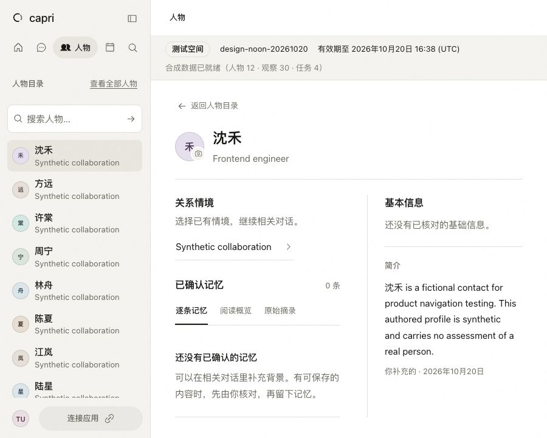||

The final after-image now uses resident `576a1b8b` after restart, with the same synthetic Person, viewport and light theme and no service alert. The earlier local candidate containing a transient service warning was replaced. Measured memory width grows 272→604px with no horizontal overflow. With the[rail collapsed](design-log/2026-10-20/round-11/web-900-collapsed.png), it is 780px. The[full reference content](design-log/2026-10-20/round-11/web-900-reference.png) remains reachable. At 1000px the single column is 704px; at 1001px the original two columns are 373/256px. At 1440px the original 740/256px split remains; at 390px the original 350px reading width remains.

[Dark900px keyboard reading mode](design-log/2026-10-20/round-11/web-dark-900-keyboard.png) retains its 2px focus and clear selected marker; original light and item mode are restored. The[390px layout](design-log/2026-10-20/round-11/web-390.png) is unchanged. Native expanded before-proof stays private because its sidebar contains an unrelated unmarked identity; the safe collapsed fictional-person baseline is already retained in Loop 9. Native after-proof verifies the same two existing fictional memories at [1123 × 865](design-log/2026-10-20/round-11/macos-default-after.png) and [900 × 720](design-log/2026-10-20/round-11/macos-narrow-after.png), plus [both memories, sources and basic information after scrolling](design-log/2026-10-20/round-11/macos-narrow-reference-after.png). The default window size is restored.

All 41 existing Person Memory interaction/page-render tests pass. Independent review finds no concrete P0–P2 at diff `abd65ef91e6aefc44196d8c7afcdbe07f9906dbaac7bccf7193aee27034b98b2`. [Verification receipt](design-log/2026-10-20/round-11/verification.json).

### Global reread — retain good structure, repair an observed composer boundary

The actual isolated [History desktop](design-log/2026-10-20/global-reread/history-1440.png), [History mobile](design-log/2026-10-20/global-reread/history-390.png) and [forced-dark primary/focus](design-log/2026-10-20/global-reread/history-forced-dark.png) remain readable with one primary action. The installed native History list also settles normally after its skeleton; its private raw capture is not published because some titles are unmarked source material. No new record was created. History structure is retained.

[Reply preferences desktop](design-log/2026-10-20/global-reread/preferences-1440.png) and [mobile](design-log/2026-10-20/global-reread/preferences-390.png) use the existing 24px title and restrained single form. Its 14px body/select are a later typography candidate; no preference was changed or saved. [Conversation desktop](design-log/2026-10-20/global-reread/conversation-1440.png) and [mobile](design-log/2026-10-20/global-reread/conversation-390.png) preserve a quiet canvas. The shared inline entry is 14px; this is a more important readability target than adding decoration.

A real keyboard defect is now reproduced: opening slash suggestions on 390 ×844 positions the menu at y75–435 while the nearest scroll-clipping canvas begins at 185. The selected first option is at y82–138.83; hit-testing its center does not reach the option. [Screenshot](design-log/2026-10-20/global-reread/composer-clipped-first-390.png), [geometry](design-log/2026-10-20/global-reread/composer-clipping-before.json). The existing placement measures the textarea wrapper rather than its absolute-positioning composer box and ignores clipping ancestors. The next bounded batch will correct those bounds and input type; it is prepared but has not started alongside the active Time writer. Actual ArrowDown does move a visible selection background; the inherited `surface-selected` token works here, so no missing-token defect is claimed. The slash test was cleared without sending. Existing focus allocated a blank local draft URL; no server record or model call was made.

macOS [native text context menu](design-log/2026-10-20/global-reread/macos-native-context-menu.png) exposes the normal Lookup, Translate, Copy, Share and Services entries on the explicitly fictional person. It was canceled without executing any action; temporary text selection was cleared. The default 1123 ×865 window is restored. [Inspection receipt](design-log/2026-10-20/global-reread/verification.json).

### Combined resident proof — Loops 7 and 11

Clean detached source `576a1b8b914fdeb2494273690f04f88b589cf43e`, build `UxvgajrhHxCNn5Rblbdcu`, passes production compilation, type checking and static generation with pinned pnpm 11.18.0. Activation passes in 22.26 seconds without rollback. A locked launchd restart passes in 17.30 seconds, changes its process and preserves the same revision/build receipt. HTTPS login validates its certificate, password-account readiness returns and API/database remain ready. The real isolated Person page still shows 604px of memory reading width at 900px after restart, with no alert or overflow. Settings reads 15px substantive text, 16px mobile search and 2px focus. No backend or native binary change was needed.

| Native Person ·900 ×720 · collapsed rail | Before (resident7c526fb0) | After (resident576a1b8b) |
| --- | --- | --- |
| Same fictional person and two memories |  |  |

Host free bytes after dependency preparation were 39,102,816,256 and after build 38,720,045,056, above 30 GiB. The Docker VM retains 4,399,532KiB of free space; Docker context stays `colima`. The storage audit's existing unsafe-Git-root warning was not treated as cleanup authority. The owned development and synthetic-fixture servers are stopped; the resident source and rollback releases remain preserved.

### Loop 10 — Escape and focus respect the editing boundary

**Decision:** independently reviewed and locally verified; resident deployment and native readback pending.

The schedule editor previously ignored Escape and left keyboard focus on the page body after its close control. Escape now uses the same existing close/dirty/unknown confirmation path. It stays local to the editor, respects IME composition, native-handled/defaultPrevented events and child propagation, and never submits. Explicit close returns focus to the actual originating control. A missing origin falls back to Add; an unresolved save that disables Add falls back to the existing enabled recovery action, then the focusable page. URL, requests, stored operation receipts and recovery semantics remain unchanged.

The first independent review found that WebKit mouse clicks need not focus their button, and that a connected disabled Add is not a usable target. A subsequent review exposed capture/bubble microtask ordering hidden by JS `.click()` tests. The final source captures the native click, consumes it synchronously during that event and uses identity-guarded task cleanup. The strengthened regression fails the earlier patch and passes final source. Final reviewed diff: `e2c1b31de7b2725d3a9610dfca1be7f5b119a81257ded1f179b1685aeacb9da6`; both P2 findings are closed.

All 108 relevant tests across 8 files, Web lint and typecheck pass. Actual390×844 Chrome input tests cancel dirty-close without losing the synthetic title, then confirm close and return focus to Add. The native select's first Escape closes its menu before the editor. No Save or record write was performed. Unknown-save recovery focus is covered by integration tests with an unchanged receipt, not by a live save attempt. [Dirty-cancel screenshot](design-log/2026-10-20/round-10/web-390-dirty-cancel.png) is a 780×1688 Retina export of the 390×844 viewport. [Earlier320px focused Save baseline](design-log/2026-10-20/round-10/web-320-save-before.png) confirms the Save action was reachable; no Save-layering defect is claimed. [Verification receipt](design-log/2026-10-20/round-10/verification.json).

The in-app browser became unresponsive at its JavaScript confirmation and its dialog API returned no active dialog. That attempt is not counted as passed. An existing Chrome Guest process supplies a new task-only window through native UI, using the same isolated run at the exclusive loopback preview origin. The resident loopback also reads back the exact synthetic account; the existing HTTPS primary browser session is untouched. Only the task's owned window and approved fixture controls are inspected.

[Matched resident390px Escape baseline](design-log/2026-10-20/round-10/web-390-escape-before.png) uses the same synthetic workspace at resident576a1b8b: pressing Escape on its blank title leaves the editor open. The post-deployment counterpart is pending.

### Loop 10 follow-up — the closed inspector must leave no empty panel

**Decision:** narrow correction reviewed and tested; resident proof pending.

Core Escape/focus source `0dd21831`, build `SniPHYkFXvRdf_rI_dZEb`, now runs from clean committed resident source. Activation passed in 37.47 seconds without rollback; HTTPS login validates its certificate and the canonical API `/health/ready` returns200. The earlier `/health`404 was an incorrect probe, not readiness proof. Actual Chrome390px Escape removes the editor and returns Add focus; the [matched after-image](design-log/2026-10-20/round-10/web-390-escape-after.png) shows the settled synthetic list. The screenshot export moves browser focus, so keyboard focus is verified separately by the actual accessibility readback. A transient service notice subsequently cleared without a source change; its cause is unconfirmed.

The installed macOS app also closes the editor and shows Add focus. At900px, however, an empty44px floating inspector remains until resize. The descendant-selector display rule is replaced by an explicit `data-open` attribute derived from the same existing editor/detail branches. Both narrow breakpoint rules use it. There is no new state, request, URL or persistence behavior. This observed rendering issue is not generalized to a proven WebKit root cause. Existing40 workspace tests and Web lint pass; independent review has no P0–P2 at diff `b4d5163508ba5997cc6a379f7f6da06427828a74024ba364c226af13effe8581`. The rejected empty-panel screenshot stays private; post-correction native proof and final restart are pending.

### Loop12 — Suggestions fit the visible reading space

**Decision:** reviewed and tested; actual clipping and forced-color correction verified locally. Final keyboard proof passes; resident and native-after proof are pending.

The slash list used the textarea wrapper as its positioning origin and ignored the scroll-clipping canvas. At390×844, its first selected option was above that canvas and its center could not hit the option. Placement now measures the outer composer and intersects clipping ancestors with the visual viewport, reserving the established header/dock space and8px gap. Absolute height stays within the available side; the existing short-window inline fallback remains. Observer and viewport/scroll subscriptions are removed on close and unmount.

|390×844, same synthetic workspace|Before|After local candidate|
|---|---|---|
|Selected first option|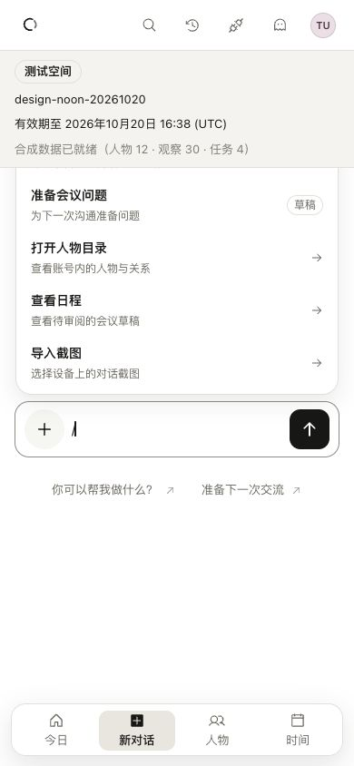|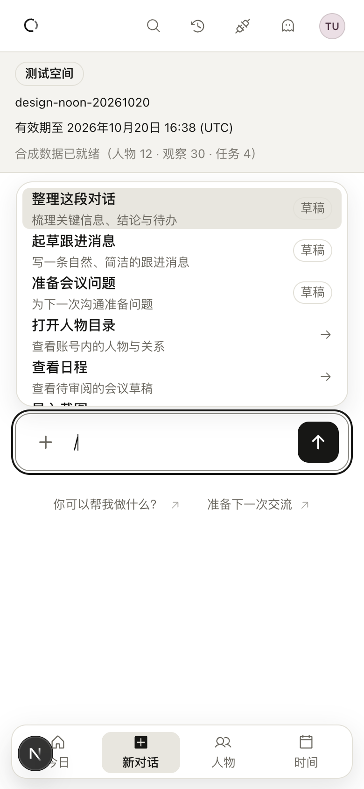|

The real visual viewport is390×844 at scale1, document/body width390 and input16px. First-option center hit changes false→true; [actual measurement](design-log/2026-10-20/round-12/web-menu-390-measure.json). The measured menu rectangle is the inner listbox; its outer panel carries the241px height budget. The PNG is a780×1688 Retina export. DevTools' ordinary screenshot action closes a blurred popup, so this export uses its task-only focused-page emulation; an earlier closed-menu image is rejected. On390×568, the original inline fallback requires scrolling the outer canvas; actual scrolling reaches both the last option and input. A transient real service warning also exercises reduced clipping space; it is retained as an abnormal state, not hidden for acceptance.

The shared inline input now uses15px on desktop/16px on narrow screens, with an exactly matching mirror,24px line height and44px adjacent controls. Labels use15px/500, metadata13px and normal transitions180ms. No new color, shadow or ornament is introduced.

Actual forced-dark inspection found black automatic text backplates covering selected labels. [Before](design-log/2026-10-20/round-12/forced-dark-backplate-before.jpg) and [after with readable draft tag](design-log/2026-10-20/round-12/forced-dark-chip-after.jpg) show the narrow correction: only selected label/tag text disables that backplate, retaining system Highlight/HighlightText and a system-color tag border. Other items and arrows retain automatic adjustment. These state captures use different selected labels and are not claimed to be an identical-row comparison. The final rule was not initially present in the browser's loaded CSS; restarting the owned preview and actually submitting its address loads the correction. The precise watcher/cache cause is unconfirmed.

A second real interaction issue appears when scrolling moves another option under a stationary mouse: its boundary-enter handler can replace the keyboard selection. The regression fails the old handler and passes an actual-pointer-movement handler that ignores touch panning. Click, keyboard choice, focus, IME and sending paths remain intact. [Pointer Events §4.1.4](https://www.w3.org/TR/pointerevents3/#boundary-events-caused-by-layout-changes) distinguishes layout boundary events from real pointer movement. Final actual UI retest passes: five ArrowDown movements reach the final Capture option without a stationary pointer replacing it; [keyboard proof](design-log/2026-10-20/round-12/keyboard-last-final.jpg).

All47 relevant parent tests across4files pass, plus63 additional worker regressions. Independent final five-file review finds no confirmedP0–P2 at `dc1cdf8034b67ef5adcb918dd0c6c9cf1675ec22a04db544523db71ae54b147e`. [Checks](design-log/2026-10-20/round-12/checks.txt), [receipt](design-log/2026-10-20/round-12/verification.json). Native resident0dd21831 before-images cover [1123×865](design-log/2026-10-20/round-12/macos-default-before.jpg), [900×720](design-log/2026-10-20/round-12/macos-narrow-before.jpg) and slash menus at [default](design-log/2026-10-20/round-12/macos-menu-default-before.jpg) and [narrow](design-log/2026-10-20/round-12/macos-menu-narrow-before.jpg). The primary authorized workspace stays on a blank unsent conversation with a collapsed sidebar; the slash is cleared and default window restored. No model call or server record is created. Native output bytes are JPEG.

Final local bounds also pass at [320px](design-log/2026-10-20/round-12/web-menu-320.png) and1440px: scale1, no document/body overflow, selected-center hit true, input16/15px respectively. The [1440px capture](design-log/2026-10-20/round-12/web-menu-1440-abnormal.png) retains a real unavailable sidebar and is explicitly abnormal-state proof. The [dark390px capture](design-log/2026-10-20/round-12/web-dark-390.png) uses DPR1; light exports use DPR2.
